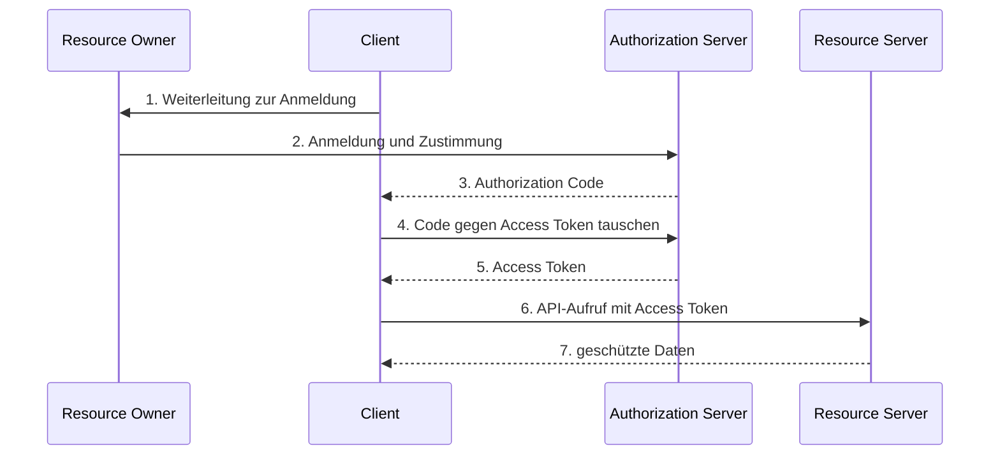

# Autorisierung

„Was dürfen Sie?"

-> **Zugriffskontrolle**


## Least Privilege

Least Privilege heißt: Ein Konto, ein Dienst oder ein Prozess bekommt nur die Rechte, die für die konkrete Aufgabe nötig sind — und nur so lange wie nötig. Der Ausgangspunkt ist „Default deny": erst einmal nichts erlauben und dann gezielt freigeben.

Das begrenzt den Schaden bei einer Kompromittierung, weil ein Angreifer nicht die Rechte des gesamten Systems erbt. Es verhindert außerdem versehentliche Änderungen, macht Rechte prüfbar und ist die Grundlage für Service-Accounts, Datenbankbenutzer, enge `sudo`-Regeln und Container ohne root.

### Umsetzung

- Minimale Zugriffsrechte pro Datei
- Kein unnötiges arbeiten als Administrator
- Getrennete Nutzer für verschiedene Kontexte
- Nur notwendige Gruppenzugehörigkeiten vergeben
- `sudo` nur für konkrete Befehle einsetzen und `/etc/sudoers` einschränken
- Je ein eigener unprivilegierter Nutzer pro Dienst
- Delegierte Autorisierung mit minimalen Scopes


## ACL

Eine Access Control List (ACL) ist eine Liste von Berechtigungen, die an einem Objekt hängt.

### POSIX-ACL

Unter Linux erweitern POSIX-ACLs das klassische Modell aus Eigentümer, Gruppe und Anderen um benannte Benutzer und Gruppen sowie eine Maske; die Permission Bits sind die Kurzform dieser ACL. Eine POSIX-ACL besteht aus der Zugriffs-ACL für das Objekt und optional aus einer Default-ACL, die Verzeichnisse an neu angelegte Inhalte vererben.

#### klassische Permission Bits

`ls -l` zeigt zuerst den Typ und danach neun Rechte-Bits: `-` steht für eine Datei, `d` für ein Verzeichnis, `l` für einen symbolischen Link. Die neun Bits bilden drei Blöcke für Eigentümer (Owner), Gruppe (Group) und Andere (Other). `r` bedeutet Lesen (4), `w` Schreiben (2), `x` Ausführen (1); die Summe ergibt den Oktalwert.

Bei Verzeichnissen bedeutet `r`: Namen auflisten; `w`: Einträge anlegen und löschen; `x`: das Verzeichnis betreten. Ohne `x` kommen Sie auch mit `r` nicht an die Inhalte.

| Datei / Verzeichnis | Art | Rechte | Oktal | Typische Verwendung |
|---|---|---|---|---|
| `id_ed25519` | Datei | `rw-------` | `600` | privater SSH-Schlüssel; nur der Eigentümer darf ihn lesen |
| `index.html` | Datei | `rw-r--r--` | `644` | öffentlich lesbare Webseite; schreiben darf nur der Eigentümer |
| `start.sh` | Datei | `rwxr-xr-x` | `755` | Skript, das alle ausführen dürfen; ändern nur der Eigentümer |
| `bericht.txt` | Datei | `rw-rw----` | `660` | Teamdatei: Eigentümer und Gruppe lesen/schreiben, Andere nicht |
| `~/.ssh` | Verzeichnis | `rwx------` | `700` | privates Verzeichnis; nur der Eigentümer betritt und listet es |
| `public_html` | Verzeichnis | `rwxr-xr-x` | `755` | Webserver darf lesen und betreten; schreiben nur der Eigentümer |
| `projekt` | Verzeichnis | `rwxrwx---` | `770` | Teamverzeichnis: die Gruppe darf lesen, schreiben und betreten |
| `/tmp` | Verzeichnis | `rwxrwxrwt` | `1777` | alle dürfen schreiben; löschen nur Datei-Eigentümer, Verzeichnis-Eigentümer und root (sticky) |

Über die neun Bits hinaus gibt es setuid (`4000`) und sticky (`1000`). setuid sorgt dafür, dass ein Programm mit den Rechten des Dateieigentümers läuft, nicht mit denen des aufrufenden Benutzers; dadurch kann ein Programm gezielt erhöhte Rechte erhalten, ist aber ein Risiko, wenn es unsicher ist. sticky sorgt bei Verzeichnissen dafür, dass nur der Datei-Eigentümer, der Verzeichnis-Eigentümer und root Einträge löschen dürfen.

`chmod` kann alle neun Bits auf einmal setzen (oktal) oder gezielt einzelne Bits ändern (symbolisch). `chmod 640` setzt die vollständigen Rechte; `chmod u+x` ergänzt nur das Ausführen-Recht für den Eigentümer.

```bash
$ ls -l bericht.txt
-rw-r--r-- 1 alice users 4096 20. Okt 10:00 bericht.txt

# Rechte auf 640 setzen
$ chmod 640 bericht.txt
$ ls -l bericht.txt
-rw-r----- 1 alice users 4096 20. Okt 10:00 bericht.txt
```

```bash
$ ls -l start.sh
-rw-r--r-- 1 alice users 1234 20. Okt 10:00 start.sh

# Ausführbar für den Eigentümer machen
$ chmod u+x start.sh
$ ls -l start.sh
-rwxr--r-- 1 alice users 1234 20. Okt 10:00 start.sh
```

Die `umask` ist keine Berechtigung, sondern eine Maske für neue Dateien und Verzeichnisse. Sie nennt die Bits, die beim Anlegen weggelassen werden: `022` ergibt `644` bei Dateien und `755` bei Verzeichnissen, `077` ergibt `600` bzw. `700`. Rechnerisch ist das `Modus & ~umask`; bestehende Dateien ändert die `umask` nicht.

```bash
$ umask
0022

# Neue Datei mit der Standard-umask anlegen
$ touch neu.txt
$ ls -l neu.txt
-rw-r--r-- 1 alice users 0 20. Okt 10:05 neu.txt

# umask für die aktuelle Shell ändern
$ umask 077

# Neue Datei mit umask 077 anlegen
$ touch privat.txt
$ ls -l privat.txt
-rw------- 1 alice users 0 20. Okt 10:05 privat.txt
```

#### erweiterte ACLs

Die neun Bits reichen nicht, wenn eine einzelne Person Leserecht auf genau eine Datei braucht, zwei Gruppen unterschiedliche Rechte haben sollen, der Webserver-User zugreifen soll, ohne Gruppenmitglied zu werden, oder neue Dateien Gruppenrechte erben sollen.

Mit `getfacl` lesen Sie die ACL, mit `setfacl` setzen Sie Einträge. Die `mask` ist die Obergrenze für benannte Benutzer, benannte Gruppen und `group::`; sie erscheint in `ls -l` als Gruppenfeld, und ein `+` zeigt die erweiterte ACL an.

```bash
$ getfacl bericht.txt
# file: bericht.txt
# owner: alice
# group: users
user::rw-
group::r--
other::---

# Lesezugriff für bob ergänzen
$ setfacl -m u:bob:r-- bericht.txt
$ getfacl bericht.txt
# file: bericht.txt
# owner: alice
# group: users
user::rw-
user:bob:r--
group::r--
mask::r--
other::---

$ ls -l bericht.txt
-rw-r-----+ 1 alice users 4096 20. Okt 10:10 bericht.txt
```

`setfacl -x u:bob bericht.txt` entfernt einen Eintrag, `setfacl -b bericht.txt` entfernt die erweiterte ACL. Default-ACLs setzen Sie mit `-d`; sie gelten nur auf Verzeichnissen und werden an neue Dateien und Unterverzeichnisse vererbt.

```bash
# Default-ACL für neue Inhalte setzen
$ setfacl -d -m u:bob:rwx projekt
$ getfacl projekt
# file: projekt
# owner: alice
# group: users
user::rwx
group::r-x
other::---
default:user::rwx
default:user:bob:rwx
default:group::r-x
default:mask::rwx
default:other::---
```

Die Prüfreihenfolge ist: Eigentümer, benannter Benutzer, Gruppenklasse (alle passenden Gruppen vereinigt und durch die Maske begrenzt), Andere.


## RBAC

RBAC (Role-Based Access Control) ordnet Rechte Rollen zu und Personen diesen Rollen. Dadurch wirkt eine Änderung an der Rolle für alle zugeordneten Personen; neue Mitarbeiter bekommen einfach die passende Rolle.

Die Grenzen: In Unix gibt es keine Rollenhierarchie, keine echte Trennung von Aufgaben, Rechte addieren sich bei mehreren Gruppen, und es gibt keine zeitliche Begrenzung.

### Unix Gruppen

Unix-Gruppen sind die einfachste Umsetzung von RBAC: Jeder Benutzer hat eine primäre Gruppe und kann Mitglied in weiteren Gruppen sein.

```bash
# alice zur Gruppe users hinzufügen
$ sudo usermod -aG users alice
$ id alice
uid=1000(alice) gid=1000(alice) groups=1000(alice),100(users)

# Eigentümer und Gruppe der Datei setzen
$ sudo chown alice:users bericht.txt

# Rechte für Eigentümer und Gruppe setzen
$ sudo chmod 660 bericht.txt
$ ls -l bericht.txt
-rw-rw---- 1 alice users 4096 20. Okt 10:20 bericht.txt
```

`usermod -aG` ergänzt eine Gruppe bei einem bestehenden Konto; ohne `-a` würden andere Zusatzgruppen ersetzt. `useradd -G` setzt Gruppen nur beim Anlegen eines neuen Kontos; auf Debian ist `adduser alice users` der bequemere Weg. `chown` ändert Eigentümer und Gruppe, `chgrp` nur die Gruppe.

## su vs sudo

| Merkmal | `su` | `sudo` |
|---|---|---|
| Ziel | Konto wechseln | einzelnes Kommando als anderer Nutzer ausführen |
| Passwort | Passwort des Zielkontos | standardmäßig das eigene Passwort |
| Rechte | alle Rechte des Zielkontos | nur die in `sudoers` erlaubten Kommandos |
| Konfiguration | keine | `/etc/sudoers` |
| Protokollierung | Sitzung, weniger kommandobezogen | Kommando und Nutzer im Auth-Log bzw. Journal |
| Least Privilege | nein | ja, wenn die Regel eng gefasst ist |
| Risiko | Root-Passwort muss geteilt werden | `NOPASSWD`, `sudo -i`, `sudo su -` |
| Typischer Einsatz | einmaliger Wechsel | delegierte Administration |

`sudo` ist nur dann Least Privilege, wenn die Regel eng ist. `NOPASSWD`, `sudo -i` und `sudo su -` können die Beschränkung aufheben, wenn die `sudoers`-Regel es erlaubt. Eine enge Regel für eine Admin-Gruppe wäre `%admins ALL=(root) /usr/bin/systemctl restart nginx`; sie wird mit `visudo` bearbeitet und erlaubt nur dieses Kommando.

## JWT
(JSON Web Token)

- **Einordnung:** JWT ist ein **Token-Format, kein Protokoll** und keine Authentifizierung.
- **Aufbau:** Ein JWT besteht aus **`Header.Payload.Signatur`**.
- **Kodierung:** Alle Teile sind **Base64**url-kodiert. Das ist keine Verschlüsselung; der Payload ist lesbar.
- **Inhalt:** Keine Passwörter, Secrets oder unnötige personenbezogene Daten in den Payload schreiben.
- **Claims:** Wichtige Claims sind `iss` (Aussteller), `sub` (Nutzer), `aud` (Empfänger/API), `exp` (Ablauf), `nbf` (nicht vor), `iat` (ausgestellt) und `jti` (Token-ID).
- **Signatur:** HS256 nutzt ein gemeinsames Secret. RS256/ES256 nutzen einen privaten Signaturschlüssel und einen öffentlichen Prüfschlüssel.
- **Schlüssel:** Bei mehreren Diensten öffentliche Schlüssel über JWKS verteilen und mit `kid` auswählen.
- **Prüfung:** Signatur, erlaubten Algorithmus, `iss`, `aud`, `exp`/`nbf` und bei Bedarf `jti` und Scopes prüfen.
- **Algorithmus:** `alg: none` nie akzeptieren und den Algorithmus nicht ungeprüft aus dem Token übernehmen.
- **Bearer-Token:** Als Access Token ist ein JWT ein **Bearer-Token**: Wer es hat, kann die API aufrufen. Kurze Laufzeit und sichere Speicherung sind wichtig.
- **Widerruf:** Ein JWT bleibt bis `exp` gültig, wenn es keine Sperrliste oder serverseitige Prüfung gibt.
- **JWT oder opakes Token:** Signatur des **JWT kann lokal geprüft werden**; Im Gegensatzt zu "opaken Token" ist keine Überprüfung durch den Autorisierungsserver zwingend.
- **OAuth2 und OIDC:** Access Tokens können JWT oder opak sein; ID Tokens sind JWT.
  - **Token-Rollen:** Das ID Token ist für den Client, das Access Token für die API.

## OAuth2

OAuth2 ist ein **Protokoll für delegierte Autorisierung**: Eine App erhält Zugriff auf geschützte Ressourcen, **ohne das Passwort** des Nutzers zu kennen.

Beteiligt sind **Resource Owner** (Nutzer), **Client** (App), **Authorization Server** (Autorisierungsserver) und **Resource Server** (z.B. Backend-API).

Der folgende Ablauf heißt **Authorization Code Flow**:

1. Der Nutzer meldet sich beim Authorization Server an und stimmt der Freigabe der angeforderten **Scopes** (Berechtigungen) zu.
2. Der Authorization Server gibt einen **Authorization Code** über den Browser zurück. Der Code ist kurzlebig, einmal verwendbar und allein kein API-Zugang.
3. Der Client tauscht den Code am **Token-Endpunkt** gegen ein **Access Token**.
4. Mit dem Access Token ruft der Client den Resource Server auf.

*Das Access Token ist ein Bearer-Token und damit der eigentliche Zugangsschlüssel: Wer es besitzt, kann die API aufrufen. Deshalb wird es nicht über den Browser-Redirect zurückgegeben, sondern direkt am Token-Endpunkt ausgegeben; dadurch landet es nicht in URL oder Browserverlauf. Der Code ist dagegen kurzlebig, einmal verwendbar und an den Client, die Redirect-URI und den PKCE-Verifier gebunden.*




<iframe width="560" height="315" src="https://www.youtube.com/embed/iX8g4LqF8p8?si=Sr5S_KP7nkofsIT-&amp;start=876" title="YouTube video player" frameborder="0" allow="accelerometer; autoplay; clipboard-write; encrypted-media; gyroscope; picture-in-picture; web-share" referrerpolicy="strict-origin-when-cross-origin" allowfullscreen></iframe>


> **💻** Praxis
>
> Resource Server: [FastAPI](https://fastapi.tiangolo.com/tutorial/security/first-steps/)
>
> Authorization Server: [Keycloak](https://www.keycloak.org/) / [Authentik](https://goauthentik.io/) / [Authelia](https://www.authelia.com/)


### Beispiel Setups

**FastAPI** wird in allen drei Beispielen als Resource Server verwendet. In den ersten beiden Beispielen übernimmt FastAPI zusätzlich die Rolle des Authorization Server; im dritten Beispiel übernimmt **Authentik** diese Rolle.

a) **FastAPI: Einfaches OAuth2 mit Passwort und Bearer-Token.** Das [Tutorial](https://fastapi.tiangolo.com/tutorial/security/simple-oauth2/) nutzt den Password Flow. Der Resource Owner meldet sich mit Benutzername und Passwort direkt an. FastAPI prüft die Zugangsdaten gegen eine feste Benutzerliste und gibt am Token-Endpunkt den Benutzernamen als Access Token zurück. JWT, Ablaufzeit und echte Passwort-Hashes fehlen.

b) **FastAPI: OAuth2 mit Passwort (und Hashing), Bearer mit JWT-Token.** Das [Tutorial](https://fastapi.tiangolo.com/tutorial/security/oauth2-jwt/) nutzt denselben Password Flow, prüft die Passwörter aber mit Argon2. FastAPI stellt ein signiertes JWT mit Ablaufzeit aus und gibt es als Access Token zurück. Bei geschützten Endpunkten prüft FastAPI das Access Token. 

c) **Authentik + FastAPI.** Hier meldet sich der Resource Owner im Browser bei [Authentik: OAuth-2.0-Provider](https://docs.goauthentik.io/add-secure-apps/providers/oauth2/) (optional per **MFA**) an und stimmt der Freigabe der **Scopes** zu. Der Client tauscht den Authorization Code am Token-Endpunkt gegen ein Access Token. FastAPI prüft das Access Token als Resource Server. Der Ablauf ist Authorization Code Flow mit **PKCE**. Wenn **OpenID Connect** gewünscht ist, kann Authentic als **OIDC-Provider** eingesetzt werden.


Die folgende Tabelle zeigt die drei Varianten im Vergleich.

| Schritt | a) FastAPI: Simple OAuth2 | b) FastAPI: OAuth2 + JWT | c) Authentik + FastAPI |
|---|---|---|---|
| 1. Login auslösen | App fragt Benutzername und Passwort ab; kein Redirect | App fragt Benutzername und Passwort ab; kein Redirect | App leitet zu Authentik; `client_id`, `redirect_uri`, `scope`, `state` und PKCE |
| 2. Anmeldung und Zustimmung | FastAPI prüft einen Fake-Benutzer; keine Zustimmung | FastAPI prüft den Argon2-Hash; keine Zustimmung | Authentik authentifiziert den Nutzer, ggf. mit MFA; Consent für Scopes, falls konfiguriert |
| 3. Code zurückgeben | entfällt | entfällt | Authentik leitet einen Authorization Code an die App zurück |
| 4. Code gegen Token tauschen | entfällt; `/token` ist direkt der Token-Endpunkt | entfällt; `/token` ist direkt der Token-Endpunkt | App sendet Code und `code_verifier` an Authentik |
| 5. Token erhalten | Benutzername als Token; kein Ablauf | signiertes JWT mit `sub` und `exp`; HS256 | Access Token von Authentik; bei OIDC zusätzlich ID Token |
| 6. API aufrufen | `GET /users/me` mit Bearer-Token | `GET /users/me` mit Bearer-Token | geschützten FastAPI-Endpunkt mit Bearer-Token |
| 7. Token prüfen | `fake_decode_token` behandelt das Token als Benutzername; keine Signaturprüfung | Signatur und `exp` prüfen; `sub` laden | Signatur über JWKS, `iss`, `aud`, `exp` und `scope` prüfen; sonst 401 oder 403 |


Die folgende Tabelle zeigt die relevanten Unterschiede zwischen dem Einsatz des Authorization Servers als reinem **OAuth2**-Provider und als **OIDC**-Provider:

| Aspekt | Authentik als reiner **OAuth2**-Provider | Authentik als **OIDC**-Provider |
|---|---|---|
| Zweck | Autorisierung für die API | Autorisierung sowie Authentifizierung und Identität |
| Token | nur Access Token | Access Token und **ID Token** (**JWT** für Client) |
| Scopes | z. B. `api.read`, `api.write` | zusätzlich `openid`, optional `profile`, `email` |
| Identität | nicht standardisiert; z. B. über `/api/me` oder Token-Claims | standardisiert über ID-Token-Claims oder UserInfo |
| FastAPI prüft | das Access Token | weiterhin das Access Token, nicht das ID Token |
| ID Token | entfällt | der Client prüft `iss`, `aud`, `exp` und ggf. `nonce` |
| Logout | kein standardisierter OIDC-Logout | End-Session-Endpunkt und Discovery verfügbar |
| MFA-Information | nicht standardisiert | über Claims wie `acr` oder `amr` möglich |
