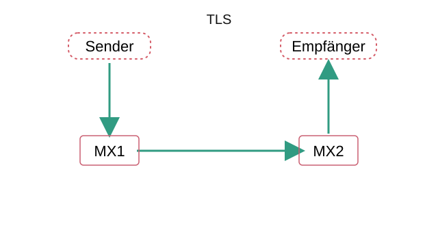
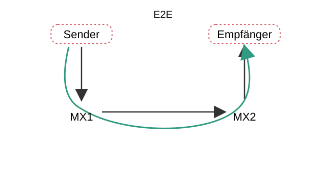

# Grundlagen

> **🧠** Tagesziel: Wir verstehen, welche TOM für Vertraulichkeit und Integrität dringend erforderlich sind, um:
>
> a) Daten auf einem Endgerät abzusichern
>
> b) Daten zwischen „Sender“ und „Empfänger“ zu übermitteln

## TOM

-> [14 „Anforderungen an die Sicherheit der Datenverarbeitung“ nach § 64 BDSG](https://johannesloetzsch.github.io/LF4/tom.html#14-anforderungen-an-die-sicherheit-der-datenverarbeitung-nach--64-bdsg)

-> Wiederholung: [Endgerätesicherheit](https://johannesloetzsch.github.io/LF4/endger%C3%A4tesicherheit.html), [SYS.2.1 „Allgemeiner Client“](https://www.bsi.bund.de/SharedDocs/Downloads/DE/BSI/Grundschutz/IT-GS-Kompendium_Einzel_PDFs_2022/07_SYS_IT_Systeme/SYS_2_1_Allgemeiner_Client_Edition_2022.html)

### Authentifizierung vs Autorisierung

| Zutritt     | Zugang               | Zugriff            |
| ----------- | -------------------- | ------------------ |
| -> Physisch | -> Authentifizierung | -> Autorisierung   |
| -> Wohin?   | -> Wer?              | -> Berechtigungen? |

> **📝❗** FiSi AP2 Konzeption Sommer 2024 Aufgabe 2
>
> Zuordnungsaufgabe: Schutzmaßnahmen wie **Datenträger verschlüsseln** und Berechtigungskonzept auf Dateiebene den Schutzzielen **Zutritts-, Zugangs- und Zugriffskontrolle** zuordnen

> **💬❓** Welche Maßnahmen zur Authentifizierung und Autorisierung kennen Sie?

-> [Methoden der Authentisierung](https://johannesloetzsch.github.io/LF4/authentifizierung.html#methoden-der-authentisierung) (Authentifizierung)

> **📝❗** FiSi AP2 Analyse Winter 2025 Aufgabe 2 da+db
>
> **Passwortpolicy** und zwei weitere **Authentifizierungsmethoden** (neben Wissen) für MFA

### Verschlüsselung

-> [Grundlagen aus LF4](https://johannesloetzsch.github.io/LF4/kryptographie.html)

#### Nach Einsatzzweck
Lokal:
- Datenträgerverschlüsselung -> z.B. Bitlocker, Veracrypt, LUKS/cryptsetup
- Dateiverschlüsselung -> z.B. GPG

Übertragung:
- Transportverschlüsselung -> z.B. TLS
- Ende-zu-Ende-Verschlüsselung (E2E) -> z.B. GPG

> **🎨** Tafelbild: Transportverschlüsselung vs E2E — Strukturanalyse Mail

#### Nach Verfahren:
- Symmetrisch -> z.B. AES, One-time pad
- Asymmetrisch -> z.B. RSA, Elliptic Curve Cryptography
- Hybrid

> **💬❓** Wie funktionieren Symmetrische und Asymmetrische Verschlüsselungsverfahren?

> **💬❓** Welche Vor- und Nachteile haben Symmetrische und Asymmetrische Verschlüsselungsverfahren?

### Signaturen
> **💬❓** Was wissen Sie zum Thema Signaturen?
> 
> Beschreiben Sie Schutzziel und Funktionsweise.

> **💬❓** Welche Schlüssel werden bei Asymmetrischer Verschlüsselung und welche für Signaturen verwendet?

| Verfahren | Sender | Empfänger | Beispiel |
| - | - | - | - |
| Symmetrische Verschlüsselung | S. verschlüsselt mit **gemeinsamen Schlüssel** | E. entschlüsselt mit **gemeinsamen Schlüssel** | |
| Asymmetrische Verschlüsselung | S. verschlüsselt mit **öffentlichen Schlüssel des Empfängers** | E. entschlüsselt mit **privaten Schlüssel des Empfängers** | [`sq encrypt` -> `sq decrypt`](https://book.sequoia-pgp.org/quickstart_confidentiality.html) |
| Digitale **Signaturen** | S. signiert mit **privatem Schlüssel des Senders** | E. verifiziert mit **öffentlichen Schlüssel des Senders** | [`sq sign` -> `sq verify`](https://book.sequoia-pgp.org/quickstart_authenticity.html)

### Hash-Funktionen
> **💬❓** Was wissen Sie zum Thema Hash-Funktionen?
> 
> Welchen Zweck erfüllen Sie?
>
> In welchem Zusammenhang zu Verschlüsselung und Signaturen stehen Hash-Funktionen?

-> Hashes sind **keine Verschlüsselung**!

-> Signaturen werden üblicherweise über den Hash der Daten berechnet

> **💬❓** Welche Anforderungen an kryptografisch starke Hash-Funktionen gibt es?

* **feste Länge** des Hash-Werts
* Urbildresistenz (**Einweg-Funktion**): aus dem Hash lässt sich keine Eingabe berechnen
* zweite Urbildresistenz: zu einer <u>bekannten</u> Eingabe **kein zweites Dokument mit demselben Hash** finden
* **Kollisionsresistenz**: <u>überhaupt kein</u> Paar verschiedener Eingaben mit demselben Hash finden

### „Codierung“
> **💬❗** Was unterscheidet Codierungen (z.B. base64) von Verschlüsselung?

* keine Schlüssel -> keine Verschlüsselung!

### Schlüsselaustausch
> **💬❓** Was sind die „großen“ Herausforderungen beim korrekten Einsatz von Kryptographie?
>
> Welche Lösungsansätze kennen Sie?

1. Direkter Schlüsselaustausch (z.B. mittels QR-Code)
2. Web-of-trust
3. PKI -> CA

> **💻** Beispiel: „GPG-Mailverschlüsselung“ via [Delta Chat](https://delta.chat/)

### Zusammenfassung

Um Vertraulichkeit in vernetzten Systemen zu gewährleisten, sind mehrere TOM gemeinsam erforderlich. Welche technischen zusätzlich zu organisatorischen Maßnahmen erforderlich sind, zeigt uns die **Strukturanalyse**:

 

* Um die Vertraulichkeit von Daten auf ausgeschalteten Geräten zu gewährleisten, sollten **Datenträger vollständig verschlüsselt** werden.
* Um Nachrichteninhalte bei der Übertragung zu schützen, hilft **Ende-zu-Ende-Verschlüsselung** am „einfachsten“ ohne komplizierte Annahmen über die auf dem Transportweg vorhandenen Systeme machen zu müssen.
* **Transportverschlüsselung** ist ein verbreiteter Kompromiss für Protokolle, die nicht von Anfang an für maximale Vertraulichkeit entwickelt wurden. Sie sollte zusätzlich zu E2E-Verschlüsselung eingesetzt werden, um Metadaten (From, To, Subject, …) auf dem Transportabschnitt zu verschlüsseln.
* Verschlüsselung alleine ist nicht ausreichend. **Zutritts-, Zugang- und Zugriffsschutz (Authentifizierung und Autorisierung)** muss bei allen beteiligten Systemen angemessen umgesetzt werden. Das gilt für:
  * Laufende datenverarbeitende Systeme — solange Schlüssel im RAM liegen, wäre Verschlüsselung sonst einfach angreifbar.
  * Protokolle zum Datenaustausch müssen Authentifizierung und Autorisierung angemessen umsetzen.
* Das **Schlüsselaustausch-Problem** ist nicht trivial und auch durch asymmetrische Verschlüsselung alleine nicht gelöst. Lösungen sind möglich und Inhalt der kommenden Unterrichtsstunden.
