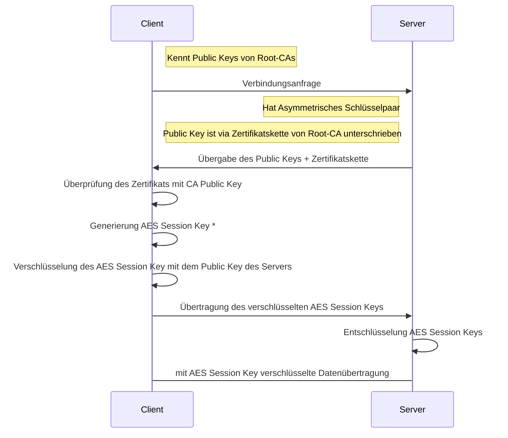
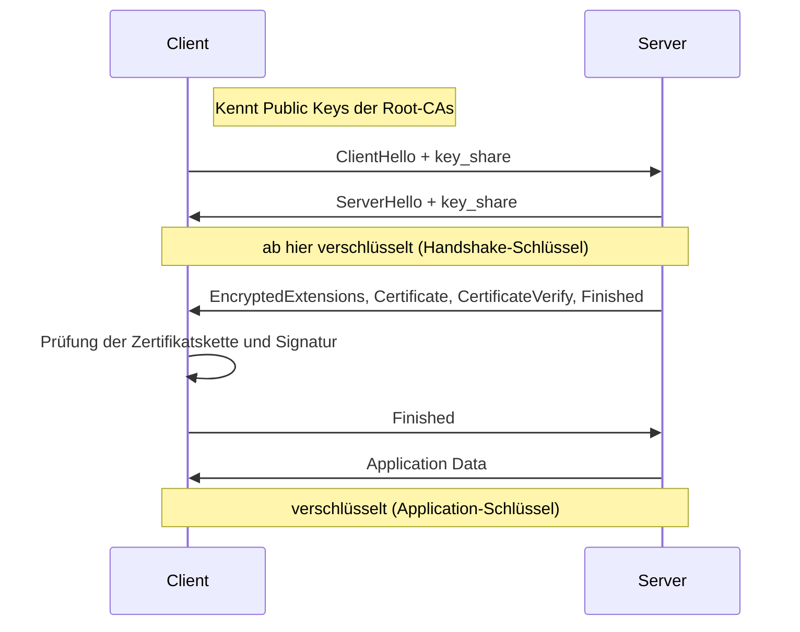

# [SSL/TLS](https://de.wikipedia.org/wiki/Transport_Layer_Security)

## Grundlagen (TLS 1.2)

> **❓❗** Was ist TLS und wie funktioniert es?

> **📝❗** FiAE AP2 Planung Winter 2022 Aufgabe 4c

> **📝❗** FiAE AP2 Planung Winter 2022 Aufgabe 1d

<!-- statt „Session Keys“ korrekter: Premaster-Secret bei RSA vom Client erzeugt; daraus wird das Master-Secret abgeleitet, daraus die Schlüssel (RFC 5246). -->

## TLS 1.3

> **💡** **BSI-Empfehlungen für den Einsatz von TLS**:
> 
> TR-02102-2 „Kryptographische Verfahren: Empfehlungen und Schlüssellängen“ [Teil 2 – Verwendung von Transport Layer Security (TLS)](https://www.bsi.bund.de/SharedDocs/Downloads/DE/BSI/Publikationen/TechnischeRichtlinien/TR02102/BSI-TR-02102-2.pdf)

> Das obige Diagramm aus der Prüfungsaufgabe zeigt den RSA-Key-Transport und gilt für `TLS 1.2 und älter` (nur RSA-Cipher-Suiten):
>
> - Der Client erzeugt den Schlüssel und verschlüsselt ihn mit dem Server-Pubkey — **ohne Forward Secrecy**; deshalb entfernt.
> - In [**TLS 1.2**](https://www.rfc-editor.org/rfc/rfc5246) daneben üblich: **(EC)DHE** (`ServerKeyExchange` -> im Diagramm als `*` markiert).
> - In [**TLS 1.3**](https://www.rfc-editor.org/rfc/rfc8446) nur noch **(EC)DHE**: Der Schlüssel kommt immer aus dem Diffie-Hellman-Austausch; das Zertifikat/die RSA-Signatur dient nur der **Authentifizierung**.

## Prüfungsaufgaben

> **📝❗** FiSi AP2 Analyse Sommer 2024 Aufgabe 2 ca–cc
>
> Mailclient per Telnet-Analyse konfigurieren: Protokoll, Verbindungssicherheit (**STARTTLS vs. SSL/TLS**) und **Authentifizierungsmethode** wählen

- **Implizites TLS** verschlüsselt ab dem ersten Byte.
- **STARTTLS** verschlüsselt eine bestehende Klartext-Verbindung nachträglich: Der Client verbindet erst unverschlüsselt und schaltet dann per `STARTTLS`-Kommando auf TLS um.
  - Ohne STARTTLS beginnt die Verbindung ungeschützt; Angreifer können die Aushandlung stören ([STRIPTLS-Angriff](https://en.wikipedia.org/wiki/Opportunistic_TLS#Weaknesses_and_mitigations)) und auf Klartext zurückdrängen.

> **📝❗** FiSi AP2 Analyse Sommer 2022 Aufgabe 3
>
> Browser-Fehler **ERR_CERT_AUTHORITY_INVALID**: Das Serverzertifikat gilt nicht als vertrauenswürdig — Ursache und Behebung

> **📝❗** FiSi AP2 Analyse Winter 2024 Aufgabe 4
>
> **SSL/TLS-Inspection** an der NGFW: Man-in-the-Middle-Mechanik, Vor- und Nachteile, rechtliche Maßnahme, **Intermediat-CA** und Behebung der Browser-Fehler **SEC_ERROR_UNKNOWN_ISSUER** und **BEHAVIOR_CHANGED**

## Praxis

> **💻** Zertifikate im Browser untersuchen und Zertifikatsfehler analysieren

> **💻** In Wireshark den TLS-Handshake nachvollziehen

> **💡💻** Praxisprojekt: Webserver mit TLS mindestens mit selbstsignierter CA integrieren

> **💡💻** [Man-in-the-middle Proxy](https://www.mitmproxy.org) für HTTP [und HTTPS](https://wiki.wireshark.org/TLS#tls-decryption)
