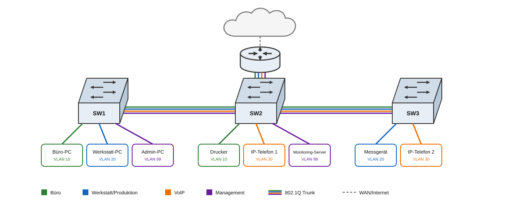

# VLAN

## Ziele

- **Broadcast-Domäne verkleinern**
- **Unabhängigkeit von der physischen Topologie**
  - **Logische Gruppen bilden** und Konfiguration vereinfachen
  - **Netzwerkmanagement verbessern**
  - **Fehlersuche und Diagnose erleichtern**
- **QoS erleichtern**, z. B. VoIP priorisieren
  - **VoIP:** Sprache und Daten trennen, Latenz/Paketverluste reduzieren, Sicherheit erhöhen, Monitoring verbessern
- **Kosten senken**: weniger Hardware/Kabel, mehrere Segmente über einen Switch
- **Traffic logisch trennen**: Daten <u>sollen</u> nur berechtigte Empfänger erreichen

Aber VLANs …:
- sind **keine Firewall** und **keine echte Sicherheitsgrenze**
- **verschlüsseln nichts**
- **authentifizieren keine Benutzer**
- **schützen nicht** vor MAC-Spoofing, ARP-Poisoning oder VLAN-Hopping
- **ersetzen keine Access-Controls** zwischen VLANs
- routen nicht von selbst; dafür braucht es eine L3-Instanz (z.B. Router)

> **📝❗** FiSi AP2 Analyse Sommer 2022 Aufgabe 2 ba
>
> **Zwei Vorteile** von VLANs beschreiben

> **📝❗** FiSi AP2 Analyse Winter 2025 Aufgabe 3 aa
>
> **Zwei Gründe** für VLANs: betriebliche und wirtschaftliche Argumente erläutern

> **📝❗** FiSi AP2 Analyse Winter 2024 Aufgabe 1 aa
>
> **Drei Vorteile** einer VLAN-Struktur beschreiben

> **📝❗** FiSi AP2 Analyse Winter 2025 Aufgabe 3 c
>
> **Eigenes VoIP-VLAN**: zwei Gründe erläutern


## Funktionsweise



### Access- und Trunk-Ports

Ein **Access-Port** gehört zu genau einem VLAN. Die VLAN-Zuordnung erfolgt **portbasiert am Switch** — Frames werden **ungetaggt** an Endgeräte übertragen.

Ein **Trunk-Port** transportiert **mehrere VLANs** über eine Verbindung, typischerweise zwischen Switches, zu einem Router oder zu einem Virtualisierungshost. Dafür werden die Frames mit **802.1Q-Tags** \* versehen. Das Tag enthält unter anderem die VLAN-ID.

| Porttyp | Typische Verbindung | VLANs | Tagging |
|---|---|---|---|
| Access-Port | Endgerät | genau eines | ungetaggt |
| Trunk-Port | Switch, Router, Hypervisor | mehrere | 802.1Q-getaggt \* |

\**Ausnahme: Das „**Native VLAN**“ wird am Trunk ungetaggt übertragen!*


### Tagging

**IEEE 802.1Q** definiert [Tags im Ethernet-Frame](https://de.wikipedia.org/wiki/IEEE_802.1Q#Tags_im_Ethernet-Frame):


> **📝❗** FiSi AP2 Analyse Winter 2024 Aufgabe 1 ba
>
> **802.1Q-Tagging**: Auswirkungen auf ein- und ausgehenden Datenverkehr erläutern

> **📝❗** FiSi AP2 Analyse Winter 2024 Aufgabe 1 bb
>
> **Tagged-Ports** am Core-Switch markieren

> **📝❗** FiSi AP2 Analyse Sommer 2022 Aufgabe 2 bb
>
> **Trunk/Uplink**: Einstellung für mehrere VLANs über eine Switch-zu-Switch-Verbindung

> **📝❗** FiSi AP2 Analyse Winter 2025 Aufgabe 3 ab
>
> **Switchport-Konfiguration** für G0/10, G0/22, G0/23 und G0/24: **VLAN-Nummern** und **untagged/tagged** ergänzen


### Subinterfaces

Ein Subinterface ist eine **logische Schnittstelle** auf einer physischen Netzwerkkarte. Es trägt ein **802.1Q-Tag** und besitzt eine eigene IP-Adresse. Über die physische Schnittstelle laufen die getaggten Frames mehrerer VLANs. Bei einer Verbindung über einen Switch muss dessen Port als **Trunk** konfiguriert sein; bei einer direkten Punkt-zu-Punkt-Verbindung zwischen zwei 802.1Q-fähigen Schnittstellen entfällt diese Switch-Konfiguration.

```bash
sudo ip link add link eth0 name eth0.10 type vlan id 10
sudo ip addr add 192.168.10.1/24 dev eth0.10
sudo ip link set eth0.10 up

sudo ip link add link eth0 name eth0.20 type vlan id 20
sudo ip addr add 192.168.20.1/24 dev eth0.20
sudo ip link set eth0.20 up

sudo sysctl -w net.ipv4.ip_forward=1
```

> **📝❗** FiSi AP2 Analyse Sommer 2025 Aufgabe 1 ac
>
> **Subinterfaces** am Router: Zweck und Begriff erläutern


## Router-on-a-Stick
(„One-armed-Router“)

Beim **Router-on-a-Stick** hängt der Router mit nur **einer physischen Schnittstelle** an einem **Trunk-Port** des Switches. Über dieses eine Kabel laufen alle VLANs. Auf dem Router wird die Schnittstelle in mehrere **Subinterfaces** aufgeteilt – eines pro VLAN. Jedes Subinterface erhält eine eigene IP-Adresse und dient den Geräten seines VLANs als Default Gateway. Damit der Router erkennt, zu welchem VLAN ein Frame gehört, muss der Trunk die Frames mit **802.1Q-Tags** versehen; am Subinterface wird das VLAN per `encapsulation dot1q` festgelegt. So routet der Router zwischen den VLANs, obwohl er nur ein Kabel zum Switch hat – daher „one-armed“ bzw. „Router on a Stick“.

> **📝❗** FiSi AP2 Analyse Winter 2025 Aufgabe 3 ba
>
> **Router-on-a-Stick / One-armed-Router**: Konzept und **Subinterfaces** erläutern

> **📝❗** FiSi AP2 Analyse Winter 2025 Aufgabe 3 bc
>
> **`encapsulation dot1q`**: Notwendigkeit von **VLAN-Tagging** beim Router-on-a-Stick erklären


## Fehlersuche

### DHCP

> **❓❗** Was ist bei Nutzung von DHCP und VLANs zu beachten?

> **📝❗** FiSi AP2 Analyse Winter 2024 Aufgabe 2 bb
>
> **DHCP in VLANs 10–40**: Ursache und Lösung für falsche IP-Adressen beschreiben


## Default VLAN

Das Default VLAN ist das VLAN, dem ein **Switch-Port ohne eigene VLAN-Konfiguration** zugeordnet wird. Bei Cisco ist das VLAN 1; alle Ports gehören zunächst dazu, und VLAN 1 kann nicht gelöscht werden. Der Begriff ist herstellerabhängig – 802.1Q schreibt kein Default VLAN vor.

## Native VLAN

Das **Native VLAN** ist die Ausnahme am 802.1Q-Trunk:

Normalerweise bekommt jeder Frame am Trunk ein **VLAN-Tag**. Beim Native VLAN verzichtet der Trunk darauf: Seine Frames werden **ungetaggt** übertragen. Der Empfänger ordnet alle ungetaggten Frames am Trunk automatisch dem Native VLAN zu.

- Das Native VLAN ist **pro Trunk und pro Switch** konfiguriert
  - Beide Trunk-Enden müssen dasselbe Native VLAN verwenden
- Standardmäßig ist es bei **Cisco VLAN 1**
- Es sollte **nicht VLAN 1** sein, sondern ein ungenutztes VLAN
  - Grund: Bei einer Abweichung landen ungetaggte Frames im falschen VLAN; bei Native VLAN = Default VLAN wird **VLAN-Hopping** erleichtert

> **📝❗** FiSi AP2 Analyse Winter 2024 Aufgabe 1 ca
>
> **Native VLAN**: Auswirkung auf den Frame-Transport über einen **Trunk** erläutern


## VLAN-Hopping

**VLAN-Hopping** bezeichnet Angriffe, bei denen Frames **unerlaubt in ein anderes VLAN** gelangen, obwohl kein Router zwischen den VLANs routet. Die VLAN-Trennung wird also umgangen.

Zwei typische Varianten:

- **Switch-Spoofing:** Der Angreifer gibt sich als Switch aus *(er handelt über Dynamic Trunking Protocol (DTP) einen **Trunk** aus)*. Danach sieht er Traffic mehrerer VLANs.
- **Double-Tagging:** Der Angreifer sendet einen Frame mit **zwei 802.1Q-Tags**. Der Switch entfernt am Trunk das äußere Tag – oft das **Native VLAN** – und leitet den Frame mit dem inneren Tag in ein fremdes VLAN weiter.

Schutzmaßnahmen:

- Access-Ports fest als Access konfigurieren
- Dynamic Trunking Protocol (DTP) deaktivieren
- Native VLAN auf ein ungenutztes VLAN legen, nicht VLAN 1
- erlaubte VLANs am Trunk begrenzen
- ungenutzte Ports abschalten

> **📝❗** FiSi AP2 Analyse Winter 2024 Aufgabe 1 cb
>
> **Native VLAN nicht VLAN 1**: Grund und **VLAN-Hopping**-Risiko erläutern


## Zuordnung von Geräten an Access-Ports

> **📝❗** FiSi AP2 Analyse Winter 2024 Aufgabe 1 ab
>
> **Portbasierte vs. dynamische VLANs**: Zuordnung von Geräten erläutern
