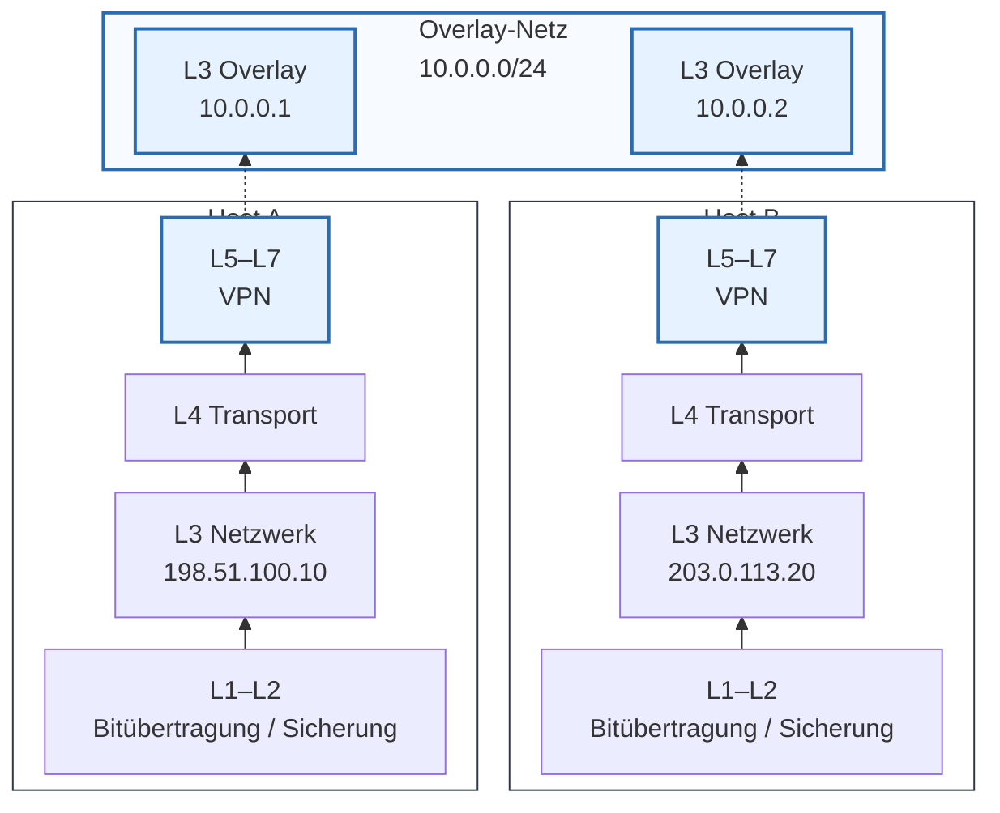

# VPN

## Ziele
<!-- Lernziel: Begriff VPN erklären, Nutzen und Schutzziele begründen. -->

> **📝❗** FiSi AP2 Analyse Sommer 2022 Aufgabe 1 ca
>
> **VPN-Begriff**: Virtual Private Network definieren

> **📝❗** FiSi AP2 Analyse Sommer 2022 Aufgabe 1 cb
>
> **Erzwungenes VPN**: zwei Vorteile begründen

> **📝❗** FiSi AP2 Analyse Winter 2025 Aufgabe 2 b
>
> **Schutzziele**: zwei Schutzziele eines VPN erläutern

## Funktionsweise
<!-- Lernziel: Overlay, Underlay und Kapselung im OSI-Modell erklären. -->



## VPN-Typen und Einsatzszenarien
<!-- Lernziel: Site-to-Site und Remote-Access unterscheiden und VPN-Endpunkte zuordnen. -->

> **📝❗** FiSi AP2 Analyse Winter 2025 Aufgabe 2 aa
>
> **Site-to-Site-VPN**: Werkstatt und Zentrale verbinden, Geräte zuordnen

> **📝❗** FiSi AP2 Analyse Winter 2025 Aufgabe 2 ab
>
> **Remote-Access-VPN**: Busfahrer und Reiseleiter anbinden, Geräte zuordnen

## Authentifizierung
<!-- Lernziel: Zertifikate und Public Keys als Vertrauensbasis vergleichen und bewerten. -->

> **📝❗** FiSi AP2 Analyse Sommer 2025 Aufgabe 3 ba
>
> **VPN-Software**: X.509-Zertifikate vs. manuell hinterlegte Public Keys bewerten

> **📝❗** FiSi AP2 Analyse Winter 2025 Aufgabe 2 da–db
>
> **VPN-Richtlinien**: Passwort-Policy erweitern und zwei MFA-Methoden beschreiben

## Betrieb

### Fehlersuche
<!-- Lernziel: VPN-Störungen eingrenzen -->

> **📝❗** FiSi AP2 Analyse Winter 2025 Aufgabe 2 c
>
> **VPN-Fehlersuche**: zwei Ursachen und jeweilige Beseitigung

### Geräte, Firewall
<!-- Lernziel: VPN-Endpunkte, Hardware-Anforderungen und Firewall-Regeln konkret umsetzen. -->

> **📝❗** FiSi AP2 Analyse Sommer 2026 Aufgabe 2 aa
>
> **Router-Aufgaben**: drei Funktionen nennen; VPN-Endpunkt als mögliche Antwort

> **📝❗** FiSi AP2 Analyse Sommer 2025 Aufgabe 3 bb
>
> **VPN-Hardware**: Krypto, Ports, Firmware-Updates und Leistungsaufnahme bewerten

> **📝❗** FiSi AP2 Analyse Sommer 2026 Aufgabe 2 ba–bb
>
> **VPN-Firewall**: Regeln für OpenVPN und dauerhaften VPN-Tunnel vervollständigen

## Praxis
<!-- Lernziel: Einfache Tunnel mit SSH erproben und VPN-Protokolle vergleichen. -->

### Schnelleinstieg via SSH

> **💡** Die folgenden SSH-Tunnel sind keine vollwertigen VPNs. Dennoch demonstrieren sie, wie hilfreiche Overlay-Netzwerke mittels eines einzigen SSH-Client-Befehls geöffnet werden können. Voraussetzung ist lediglich ein existierender SSH-Server, der die Funktion des „VPN-Servers“ übernimmt.

> **💻 `ssh -L`:** Lokale Portweiterleitung: Der Dienst auf Port **80 des SSH-Servers** wird auf Port **8080 deines Clients** erreichbar.
>
> ```bash
> ssh -N -L 8080:localhost:80 user@server
> ```

> **💻 `ssh -R`:** Remote-Portweiterleitung: Der Dienst auf Port **80 deines Clients** wird auf Port **8080 des SSH-Servers** erreichbar.
>
> ```bash
> ssh -N -R 8080:localhost:80 user@public-server
> ```

> **💻 `ssh -D`:** Dynamischer SOCKS-Proxy auf `localhost:1080`.
>
> ```bash
> ssh -N -D 1080 user@server
> ```
>
> Dann den Browser oder andere Anwendung auf SOCKS5 `127.0.0.1:1080` einstellen — Der Datenverkehr läuft dann über den SSH-Server, etwa für den Zugriff auf interne Webdienste von außen oder in unsicheren Netzen.

> **💻 `ssh -J`:** Sprung über einen Jump-Host.
>
> ```bash
> ssh -J jumpuser@jump-host user@target
> ```

> **💻 `ssh -o ProxyCommand`:** Eigener Proxy- oder Tunnelbefehl.
>
> ```bash
> ssh -o ProxyCommand="ssh -W %h:%p jumpuser@jump-host" user@target
> ```

> **💻 `ssh -w`:** TUN-Device für ein L3-Overlay — root nötig; Interfaces müssen händig konfiguriert werden
>
> ```bash
> sudo ssh -N -w 0:0 user@server
> ```

> **💻 `sshuttle`:** SSH-basiertes VPN für Subnetze: route `10.0.0.0/24` über `server`
>
> ```bash
> sshuttle -r user@server 10.0.0.0/24
> ```

### Vergleich

| Protokoll | Schicht | Verschlüsselung | Bewertung |
|---|---|---|---|
| **WireGuard** | L3 | Noise/ChaCha20-Poly1305 | modern, schnell, schlank |
| **OpenVPN** | L3/L2 | TLS | flexibel, verbreitet, komplexer |
| IPsec | L3 | ESP/AH, IKE | Standard, komplex, NAT-Themen |
| L2TP/IPsec | L2 über L3 | IPsec | L2TP allein unverschlüsselt |
| ~~PPTP~~ | ~~L2~~ | ~~MPPE~~ | ~~unsicher, nicht einsetzen~~ |
