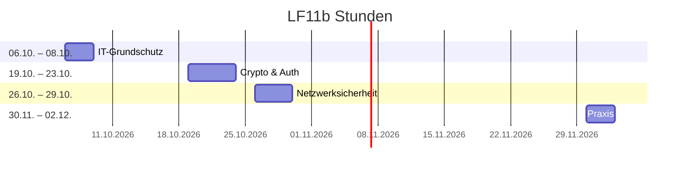
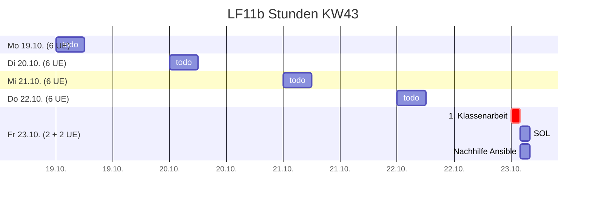
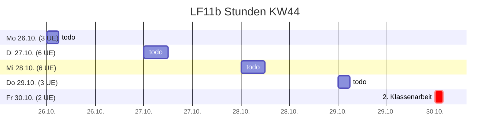

# Plan

## Zeitplan

### Grundlagen Datenschutz und Datensicherheit

06.10.:
* Einordnung [Datenschutz und Datensicherheit](https://johannesloetzsch.github.io/LF4/dud.html)
* Datenschutzrecht
  * [Gesetze](https://johannesloetzsch.github.io/LF4/datenschutz.html)
    * DSGVO, BDSG, …
  * [Prinzipien](https://johannesloetzsch.github.io/LF4/datenschutz_prinzipien.html)
    * Verbot mit Erlaubnisvorbehalt
    * Grundsätze für die Verarbeitung personenbezogener Daten
    * Betroffenenrechte
    * Verarbeitung besonderer Kategorien personenbezogener Daten
    * Melde-/Benachrichtigungspflichten
  * [Verantwortlichkeiten](https://johannesloetzsch.github.io/LF4/datenschutz_verantwortlichkeiten.html)
  * [Datensparsamkeit](https://johannesloetzsch.github.io/LF4/datensparsamkeit.html)
* [Datensicherheit](https://johannesloetzsch.github.io/LF4/datensicherheit.html)

* [IT-Grundschutz-Methodik](https://johannesloetzsch.github.io/LF4/grundschutz.html)
  * Basis-, Kern-, Standardabsicherung

07.10.:
* [IT-Sicherheitsmanagement](https://johannesloetzsch.github.io/LF4/ism.html)
* [Gefährdungen](https://johannesloetzsch.github.io/LF4/gef%C3%A4hrungen.html#gef%C3%A4hrdungen-mit-besonderer-relevanz-f%C3%BCr-die-ihk-pr%C3%BCfung)
  * DoS
  * Phishing
  * Arten von Malware: Würmer, Trojaner, Ransomware
* [Vulnerability -> Exploit](https://johannesloetzsch.github.io/LF4/vulnerabilities.html)
* [Schutzbedarfsanalyse](https://johannesloetzsch.github.io/LF4/schutzbedarfsanalyse.html)
> Interaktive Übung zu Strukturanalyse und Schutzbedarfsfeststellung am Beispiel „Mail“

08.10.:
* [IT-Grundschutz-Methodik](https://johannesloetzsch.github.io/LF4/grundschutz.html)
  * [Ablauf Standard-Absicherung](https://johannesloetzsch.github.io/LF4/grundschutz_methodik.html)
  * Wiederholung [Schutzbedarfsanalyse](https://johannesloetzsch.github.io/LF4/schutzbedarfsanalyse.html)

* [IT-Grundschutz-Check](https://johannesloetzsch.github.io/LF4/grundschutz_check.html)
* [Grundlagen TOM](https://johannesloetzsch.github.io/LF4/tom.html)
  * [Endgerätesicherheit](https://johannesloetzsch.github.io/LF4/endger%C3%A4tesicherheit.html)
* [Ablauf Standard-Absicherung](https://johannesloetzsch.github.io/LF4/grundschutz_methodik.html)
  * [Risikoanalyse](https://johannesloetzsch.github.io/LF4/risikoanalyse.html)
> Gruppenarbeit "Risikoanalyse" -> IT-Grundschutz (vereinfacht) mittels [Vorlage für Praxisprojekt](./material/projektarbeit_lf11b.pdf) an eigenem Beispiel

### KW43: Crypto & Auth 

19.10.:
* Überleitung vom [Datenschutzrecht](https://johannesloetzsch.github.io/LF4/datenschutz.html) und organisatorischen Maßnahmen zu [TOM](https://johannesloetzsch.github.io/LF4/tom.html)
* Wiederholung Krypto-Grundlagen
  * symmetrische vs. asymmetrische [Kryptographie](https://johannesloetzsch.github.io/LF4/kryptographie.html)
  * Hashes
* Überblick [Authentifizierung](https://johannesloetzsch.github.io/LF4/authentifizierung.html)
  * Passwörter, 2FA/MFA
  * ACL
* Ausblick: Schlüsselaustausch-Problem
> Praxis: `/etc/shadow`, `chmod`, SSH-Keys

20.10.:
* [Verschlüsselung](https://johannesloetzsch.github.io/LF4/kryptographie.html) unterscheiden: Datenträger-, Transport-, Ende-zu-Ende
* [Hybride Verschlüsselung](https://johannesloetzsch.github.io/LF4/kryptographie.html)
* [Signaturen](https://johannesloetzsch.github.io/LF4/kryptographie.html) und Schlüsselaustausch
  * PKI vs. Web-of-Trust
  * CA, X.509 → [SSL/TLS](https://johannesloetzsch.github.io/LF4/tls.html)
> Praxis: PGP/GPG

21.10.:
* [Authentifizierung](https://johannesloetzsch.github.io/LF4/authentifizierung.html) und Autorisierung: relevante TOMs raussuchen, unterscheiden, erklären
* [Passwörter](https://johannesloetzsch.github.io/LF4/passwoerter.html) und [Dateiberechtigungen (ACL)](https://johannesloetzsch.github.io/LF4/dateiberechtigungen.html)
* [SSO](https://johannesloetzsch.github.io/LF4/sso.html), OAuth2, OIDC, SAML
> Praxis: [FastAPI-Security](https://fastapi.tiangolo.com/tutorial/security/first-steps/), Keycloak/Authentik/Authelia

22.10.:
* Wiederholung inkl. TOM-Abfrage
* [Endgerätesicherheit](https://johannesloetzsch.github.io/LF4/endger%C3%A4tesicherheit.html): SYS.2.1 „Allgemeiner Client“ noch präsent?

23.10.:
* Klassenarbeit (2 UE)
* SOL: Prüfungsaufgaben

### KW44: Netzwerksicherheit

<!--

## Leistungskontrollen
* **Fr 28.11. Klassenarbeit: doppelte Wertung, 90min, handschriftlich**
  * Erlaubte Hilfsmittel: A4 Factsheet einseitig
  * Themen: Alles was im Unterricht in der KW48 behandelt wurde…
  * **Schwerpunkte**:
    * [Datenschutz & Datensicherheit](https://johannesloetzsch.github.io/LF4/dud.html): Begriffsunterscheidung
      * [Datenschutz](https://johannesloetzsch.github.io/LF4/datenschutz.html): 2 besonders relevante Gesetze
        * [Prinzipien](https://johannesloetzsch.github.io/LF4/datenschutz_prinzipien.html): Verbot mit Erlaubnisvorbehalt, Zweckbindung
        * [Datensparsamkeit](https://johannesloetzsch.github.io/LF4/datensparsamkeit.html): Privacy by Default, Privacy by Design, Anonymität, Pseudonymität
      * [Datensicherheit](https://johannesloetzsch.github.io/LF4/datensicherheit.html): Safety vs. Security, Schutzziele / Hauptziele / Grundwerte, Relative Sicherheit, „Stand der Technik“, Qualität
        * [Sicherheitsmanagement](https://johannesloetzsch.github.io/LF4/ism.html): ISO 27001, IT-Grundschutz-Methodik
    * [Gefährdungen](https://johannesloetzsch.github.io/LF4/gefährungen.html): Malware, Ransomware, Würmer, Trojaner, Phishing, Spear-Phishing, DoS, DDoS
    * [TOM](https://johannesloetzsch.github.io/LF4/tom.html) (verstehen)
      * [Endgerätesicherheit](https://johannesloetzsch.github.io/LF4/endgerätesicherheit.html) (Maßnahmen beschreiben)
      * [Grundlagen Authentifizierung](https://johannesloetzsch.github.io/LF4/authentifizierung.html)
      * [Grundlagen Kryptographie](https://johannesloetzsch.github.io/LF4/kryptographie.html)
    * [IT-Grundschutz-Methodik](https://johannesloetzsch.github.io/LF4/grundschutz.html): Basis-, Kern-, Standard-Absicherung
      * [Vorgehen](https://johannesloetzsch.github.io/LF4/grundschutz_methodik.html)
      * [Schutzbedarfsanalyse](https://johannesloetzsch.github.io/LF4/schutzbedarfsanalyse.html) 
      * [Risikoanalyse](https://johannesloetzsch.github.io/LF4/risikoanalyse.html)
      * [IT-Grundschutz-Check](https://johannesloetzsch.github.io/LF4/grundschutz_check.html) (Nutzung von IT-Grundschutz-Bausteinen, Arbeiten mit Checklisten)

* **zweite Klassenarbeit** => 19.12. (AE) bzw. 09.01. (SI)

* **Projektarbeit**:
  * Vorlage (Vorschlag): [pdf](material/projektarbeit_lf11b.pdf), [odt](material/projektarbeit_lf11b.odt)

  * eine kleine Note für Projektplanung (insbesondere Schutzbedarfsanalyse) => SOL vom 28.11.
  * zwei kleine Noten (Projektergebnis + Mitarbeit) => Präsentation am 09.01.

## Bonus
=> Bei Interesse bitte melden

* [ ] Weitere Praxisbeispiele
* [ ] Hackerethik (vs. [202c StGB](https://www.gesetze-im-internet.de/stgb/__202c.html))
* [ ] CTF
* [ ] „Live Hacks“ z.B.
  * [ ] SQL-Injection
  * [ ] Netzwerksicherheit
    * [ ] MITM-Proxy
    * [ ] NMap
    * [ ] Wireshark / TCPdump
  * [ ] Binary Exploitation

-->
